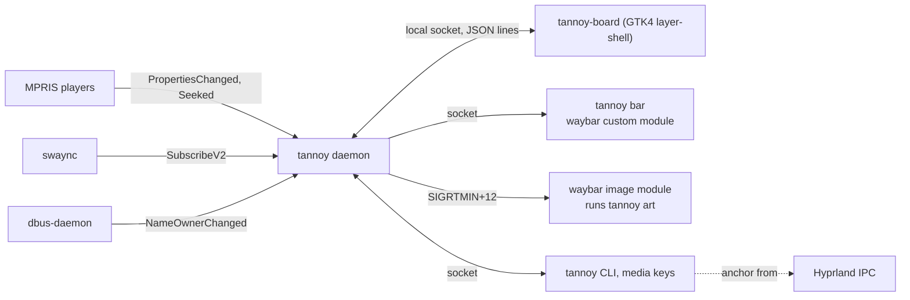

# Tannoy design

Tannoy is a now-playing widget for a Wayland bar. The bar shows the cover
and `artist · title`; clicking it opens a drawer that springs out of that
icon with the cover, a scrub bar, the controls and the players. This
document is the reference for how it works and why. The README is the tour;
this is the spec.

## Goals

1. **Signals, not polling.** Metadata, state, players and do not disturb all
   arrive as D-Bus signals. Nothing samples on a timer while the drawer is
   closed.
2. **The player you meant.** Commands and the bar follow the user's pick,
   else the most recently playing player, so two open players never fight
   over the media keys.
3. **Private by default.** Do not disturb hides the title and the cover
   everywhere they would show on screen.
4. **Zero setup.** Every MPRIS player is found on its own; the theme comes
   from the bar.

## Non-goals

- **Not a player.** Tannoy controls players over MPRIS. It never plays
  audio, keeps a library or a queue.
- **Not a mixer.** The output row names the default device and runs your
  own switcher. Volume stays with the bar's audio module.
- **No lyrics, no scrobbling.** Both need network services Tannoy does not
  talk to.

## Architecture



| Crate | Role |
|---|---|
| `bar-anchor` | Hyprland anchoring and panel placement. A copy of Roundhouse's; its `Anchor` JSON is the same as Roundhouse's and Switchyard's. |
| `tannoy-core` | The model, MPRIS parsing, the player pick, config, cover art, the socket protocol, the waybar reader and the swaync and wpctl parsers. No D-Bus, no UI. |
| `tannoy` | The `tannoy` binary: daemon, CLI and waybar module. Owns the zbus connection. |
| `tannoy-board` | The Linux drawer: GTK4 on `gtk4-layer-shell`, overlay layer, namespace `tannoy`, keyboard exclusive while open. |

## Paths

| What | Where | Override |
|---|---|---|
| Config | `~/.config/tannoy/config.toml` | `TANNOY_CONFIG_DIR` |
| User stylesheet | `~/.config/tannoy/style.css` | `TANNOY_CONFIG_DIR` |
| Picked player | `$XDG_STATE_HOME/tannoy/state.json` | `TANNOY_STATE_DIR` |
| Logs | `$XDG_STATE_HOME/tannoy/daemon.log`, `board.log` | `TANNOY_STATE_DIR` |
| Cover cache | `$XDG_CACHE_HOME/tannoy/art/` | `TANNOY_CACHE_DIR` |
| Socket | `$XDG_RUNTIME_DIR/tannoy/tannoy.sock` | `TANNOY_RUNTIME_DIR` |
| Daemon lock | `$XDG_RUNTIME_DIR/tannoy/daemon.lock` | `TANNOY_RUNTIME_DIR` |

The runtime directory is mode 0700 and the socket 0600. The daemon holds an
`flock` on the lock file for its lifetime: the bar module and a media key can
both start a daemon at the same moment, and the loser exits instead of
unlinking the winner's socket.

## MPRIS

The daemon keeps one session-bus connection (zbus, blocking API, every
method call limited to 3 seconds) and four signal streams:

| Signal | Match | Effect |
|---|---|---|
| `NameOwnerChanged` | `org.freedesktop.DBus` | A name under `org.mpris.MediaPlayer2.` gaining an owner is loaded; losing one forgets the player. `org.erikreider.swaync.cc` coming or going rereads do not disturb. |
| `PropertiesChanged` | path `/org/mpris/MediaPlayer2` | `Metadata`, `PlaybackStatus`, `Rate`, `Can*` on the Player interface; `Identity` and `DesktopEntry` on the root interface. An invalidated property makes the daemon read the player again. |
| `Seeked` | `org.mpris.MediaPlayer2.Player` | The new position. |
| `SubscribeV2`, `Subscribe` | `org.erikreider.swaync.cc` | Do not disturb (the second argument). |

Signals carry the sender's unique name (`:1.39`), so loading a player first
asks `GetNameOwner` and records the mapping, then calls `GetAll` on both
interfaces. Loading runs on a helper thread: a hung player costs a thread,
never the bar. `org.mpris.MediaPlayer2.playerctld` is always ignored because
it mirrors another player.

MPRIS never signals the position. While the drawer reports it is visible
(`board_visible`), the daemon reads `Position` from the active player about
once a second; the drawer extrapolates between readings from `position`,
`position_at` and `rate`. With the drawer closed the position is only what
the last status change, `Seeked` or command left behind.

The parsers in `tannoy_core::mpris` take plain values (`MValue`), not zbus
types, and are tested against `GetAll` dumps recorded with
`busctl --json=pretty` (see `crates/tannoy-core/fixtures/`).

A track reads as a **podcast** when its `mpris:trackid` contains `episode`
or `podcast` (Spotify episodes are `/com/spotify/episode/...`), a genre
contains "podcast", or it is longer than 20 minutes and has no album (a
podcast or a talk in a browser tab).

## Player pick

`tannoy_core::pick::choose`:

1. The **pick**, stored by key, wins while any player with that key exists,
   whatever its state. The key is the bus name after the prefix, up to
   `.instance` and lowercased: `chromium.instance910` is `chromium`, so the
   pick survives a restart.
2. Otherwise a playing player, the one that most recently started playing.
3. Otherwise the one that was playing most recently, then paused over
   stopped, then bus-name order.

`tannoy pick <query>` matches a key, a bus-name suffix or an `Identity`
("Chrome"), exactly or as a prefix, case-insensitively. `auto` (or `none`)
clears the pick. The pick is saved to `state.json` as `{"picked": "spotify"}`.

Every command goes to the active player. Seeking reads `Position` fresh
first, clamps the target to the track (one second short of the end, since
seeking past it skips the track in most players) and uses `SetPosition` when
the track id is usable, else `Seek` with the difference.

## The bar

`tannoy bar` subscribes to the daemon and prints a waybar JSON line whenever
it changes. If the daemon is not running it starts one (detached, in its own
session) once; while it cannot connect it prints an empty `offline` line and
retries every 2 seconds.

| State | Text | Class |
|---|---|---|
| No player, a stopped player, or an empty track | empty (waybar hides the module) | `stopped` |
| Do not disturb is on and `dnd.hide` | `bar.icon_hidden`, then `dnd.text` | `hidden` |
| Playing | `bar.icon_playing`, then `artist · title` | `playing` |
| Paused | `bar.icon_paused`, then `artist · title` | `paused` |
| Daemon unreachable | empty | `offline` |

The text is `artist`, `bar.separator` and `title` (or whichever exists),
shortened by `tannoy_core::text::ellipsize`: at most `bar.max_chars`
characters, cut at the last word boundary with `…`, with a dangling
separator dropped. Only a single word longer than the limit is cut inside
itself. The tooltip is the full title, artist, album and player; while
hidden it only says that do not disturb hides the title. Text and tooltip
are escaped for Pango markup.

## Do not disturb

The rule from the script Tannoy replaced: while swaync's do not disturb is
on, the title stays off screen. With `dnd.hide = true` (the default):

- the bar shows only the hidden glyph, with no title in the tooltip;
- `tannoy art` prints no cover, so the image module hides;
- the drawer shows a "Hidden" card instead of the cover and title, and keeps
  the controls, players and output row;
- `tannoy status` prints "hidden while do not disturb is on".

Do not disturb is read with `GetDnd` at startup and whenever swaync's name
appears, and follows `SubscribeV2` after that. Without swaync it is off.

## Cover art

The active track's `mpris:artUrl` is cached into `$XDG_CACHE_HOME/tannoy/art/`
on a helper thread:

- `file://` (Chrome writes a temporary file per cover; local players point at
  the album folder): copied. The cache key covers the URL, size and
  modification time. A file that is not readable yet gets three more tries
  300 ms apart.
- `https://` and `http://` (Spotify's `i.scdn.co`): downloaded with ureq and
  rustls, `art.timeout` seconds, at most 10 MB.

Only PNG, JPEG, WebP, GIF and BMP are kept (by their first bytes), named
`<fnv64 of the key>.<ext>`. The newest 200 files stay; older ones are pruned
after each fetch.

`tannoy art` asks the daemon (400 ms deadline, never starts it, since waybar
runs it on its main thread) and prints the cover's path, or with no cover
`$XDG_CACHE_HOME/tannoy/art/none`, which is never created: waybar hides an
image module whose path does not exist, but an empty line leaves the
previous image up. There is no cover with no active track, a stopped
player, do not disturb hiding titles, or `art.enabled = false`. With no cover, `art.fallback = "player"`
prints the player's app icon from the hicolor theme or `/usr/share/pixmaps`,
and any other value is an image path.

When what `tannoy art` would print changes, the daemon sends
`SIGRTMIN+art.signal` to each waybar process of the same user that catches
it (read from `SigCgt` in `/proc/<pid>/status`, since an uncaught real-time
signal kills the process). Waybar catches `SIGRTMIN+1` and up.

## Anchoring

As in Roundhouse: `tannoy toggle` asks Hyprland's IPC socket for the cursor,
its monitor and the bar's layer surface (`bar.namespace`) while the cursor
is still on the icon, and sends the `Anchor` with the request. The drawer
covers the monitor with a transparent overlay surface, places the panel
next to the bar centered on the click (`bar_anchor::place`), and scales it
open from the click point. A click outside the panel closes it. Without
Hyprland, or with `--center`, it opens centered.

## Theme

With `theme.from = "waybar"` the drawer reads waybar's `style.css` the way
Roundhouse does: the font on `*` or `window#waybar`, the bar's background
and text colors, the first module border color, the first `:hover`
background and every `@define-color`. Only the RGB of the bar background is
used and the alpha is forced to 1 (the panel itself is 0.97), so a
transparent floating bar still gives an opaque drawer. `accent` or `frost`
becomes the accent; `green`, `yellow` and `red` become the playing, hidden
and error colors. Layers, lowest first: the built-in `style.css`, the
bar-derived tokens, `~/.config/tannoy/style.css`. The drawer watches all
three and the config.

## Output device

The drawer, not the daemon, runs `wpctl inspect @DEFAULT_AUDIO_SINK@` and
`wpctl get-volume @DEFAULT_AUDIO_SINK@` on a helper thread when it opens,
and shows `node.description` (else `node.nick`, else `node.name`), the
volume and a Bluetooth glyph when `device.api` is `bluez5`. The Change
button closes the drawer (the switcher usually needs the keyboard), runs
`output.command` with `sh -c`, and reads the device again when it exits.

## Protocol

Newline-delimited JSON on the socket, one request per line, one reply per
request. Shapes follow Roundhouse's and Switchyard's.

```json
{"cmd":"ping"}
{"cmd":"snapshot"}
{"cmd":"art"}
{"cmd":"subscribe","kind":"bar"}
{"cmd":"subscribe","kind":"board"}
{"cmd":"toggle","anchor":{"monitor":"DP-2","edge":"bottom","x":1720,"y":1417,"width":2560,"height":1440,"reserved":[0,0,0,40],"center":false}}
{"cmd":"show","anchor":null}
{"cmd":"hide"}
{"cmd":"board_visible","visible":true}
{"cmd":"play_pause"}
{"cmd":"next"}
{"cmd":"previous"}
{"cmd":"seek","offset":-15.0}
{"cmd":"set_position","position":90.0}
{"cmd":"pick","player":"spotify"}
{"cmd":"pick","player":null}
```

Replies are `{"ok":true}` with optional `snapshot`, `version`, `art` or
`error`. Commands wait up to 3 seconds for the daemon's first scan of the
bus, so a media key that starts the daemon still reaches a player.

A `board` subscription receives `{"event":"snapshot","snapshot":{...}}` on
every change, plus `{"event":"show",...}`, `{"event":"toggle",...}` and
`{"event":"hide"}`. A `bar` subscription receives waybar JSON lines, already
formatted, only when they change. When a toggle arrives and no drawer is
subscribed, the daemon starts `tannoy-board` (next to `tannoy`, else on
`PATH`) and holds the show until it subscribes.

The snapshot (`tannoy status --json`) is `version`, `now`, `players` (each
with `bus`, `key`, `name`, `desktop_entry`, `status`, `track`, `position`,
`position_at`, `rate`, the `can_*` flags and `last_playing`), `active`,
`picked`, `dnd`, `hidden`, `art` and `config_error`. Positions and lengths
are microseconds, times are Unix seconds.

## Config keys

| Key | Default | Meaning |
|---|---|---|
| `bar.max_chars` | `40` | Longest bar text in characters |
| `bar.separator` | `" · "` | Between artist and title |
| `bar.icon_playing` | `""` | Glyph before the text while playing |
| `bar.icon_paused` | `""` | Glyph before the text while paused |
| `bar.icon_hidden` | `"\U000F075A"` | What do not disturb leaves in the bar |
| `bar.namespace` | `"waybar"` | The bar's layer-shell namespace, for anchoring |
| `dnd.hide` | `true` | Hide title and cover while do not disturb is on |
| `dnd.text` | `""` | Text after `icon_hidden` while hidden |
| `art.enabled` | `true` | Cache covers for `tannoy art` and the drawer |
| `art.signal` | `12` | `SIGRTMIN+N` sent to waybar on a cover change; `0` sends nothing |
| `art.fallback` | `"none"` | No cover: `none`, `player` (app icon) or an image path |
| `art.timeout` | `5` | Seconds for an https download |
| `players.ignore` | `[]` | Keys or bus-name suffixes never tracked (`playerctld` always is) |
| `drawer.width` | `400` | Panel width in logical pixels |
| `drawer.max_height` | `0.85` | Largest height as a fraction of the monitor |
| `drawer.gap` | `8` | Gap between the bar and the panel |
| `drawer.skip` | `15` | Seconds the podcast buttons jump |
| `drawer.skips` | `"auto"` | Skip buttons: `auto` (podcasts), `always`, `never` |
| `output.command` | `"~/.config/waybar/scripts/audio-switch.sh output"` | Run by the Change button; empty hides it |
| `theme.from` | `"waybar"` | `waybar` or `none` |
| `theme.accent` | none | Overrides the accent color |
| `theme.font` | none | Overrides the font family |

Unknown keys are errors: the defaults are used and the drawer and
`tannoy doctor` say what is wrong. The daemon rereads the config within 2
seconds of a change.

## Keyboard

| Key | Action |
|---|---|
| <kbd>Space</kbd>, <kbd>k</kbd> | Play or pause |
| <kbd>←</kbd>, <kbd>j</kbd> | Back 5 seconds |
| <kbd>→</kbd>, <kbd>l</kbd> | Forward 5 seconds |
| <kbd>n</kbd>, <kbd>p</kbd> | Next, previous |
| <kbd>Esc</kbd> | Close |
